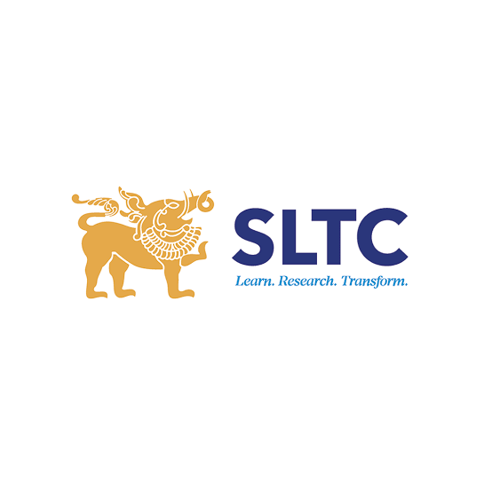

<!-- ===================================================== -->
<!--                 DUREKSHA ARANGALA                     -->
<!--              GITHUB PROFILE README                    -->
<!-- ===================================================== -->

<!-- HERO BANNER -->

  

<h1 align="center">Hi, I'm Dureksha Arangala 👋</h1>

<h3 align="center">
  Final-Year Data Science Undergraduate
</h3>

  
  
  
  

  

  
  
  

---

## 👩‍💻 About Me

I'm a **final-year BSc (Hons) Data Science undergraduate** at Sri Lanka Technology Campus (SLTC), passionate about transforming data into meaningful insights and developing intelligent, data-driven solutions.

My interests include Data Science, Machine Learning, Deep Learning, Artificial Intelligence, Big Data Analytics and Applied AI Research.

I enjoy working on practical projects that combine analytical thinking, programming and problem-solving. I am continuously exploring new technologies, strengthening my technical foundation and developing solutions through academic projects and independent learning.

- 🎓 BSc (Hons) in Data Science – SLTC
- 📊 Interested in Data Science and Machine Learning
- 🤖 Exploring Deep Learning and Explainable AI
- 🔬 Interested in Applied AI Research
- 🌱 Continuously learning and building projects
- 🤝 Open to learning, collaboration and internship opportunities

 

---

## 🎓 Education

<table>
<tr>
<td width="25%" align="center" valign="middle">
  
</td>
<td width="75%" valign="middle">

### BSc (Hons) in Data Science

**Sri Lanka Technology Campus (SLTC)**  
Faculty of Computing & IT

📅 2023 – Present

**Academic Status:** Final-Year Undergraduate  
**Current GPA:** 3.74

</td>
</tr>
</table>

---

## 🛠️ Technical Skills

### Programming Languages

  

### Data Science & Analytics

  
  
  
  
  

### Machine Learning & Deep Learning

  
  
  
  
  

### Databases & Big Data

  
  

### Development & Tools

  
  
  
  

---

## 🚀 Featured Projects

<table>
<tr>
<td width="50%" valign="top">

### 🧠 Liyaa – Postpartum Depression Prediction

An ongoing final-year research project focused on predicting postpartum depression risk and supporting recovery through a digital platform.

**Technologies:**

Python · Scikit-learn · TensorFlow · SHAP · Flutter · Supabase · PostgreSQL · Dialogflow CX

**Highlights:**
- Machine learning-based risk prediction.
- Explainable AI for model interpretation.
- Digital assessments and recovery support.
- Mobile application development.

</td>
<td width="50%" valign="top">

### 🌱 SmartCrop – ANN-Based Crop Recommendation

An artificial neural network-based crop recommendation system that considers soil and weather conditions alongside regional crop supply signals.

**Technologies:**

Python · Artificial Neural Networks · Machine Learning · Pandas · Scikit-learn

**Highlights:**
- Uses agricultural and environmental features.
- Explores regional crop supply and surplus signals.
- Supports data-driven crop selection.

</td>
</tr>

<tr>
<td width="50%" valign="top">

### 📊 E-Commerce Big Data Analytics Pipeline

A big data analytics project exploring e-commerce datasets through data processing, transformation and analysis.

**Technologies:**

Python · Pandas · NumPy · PySpark · MongoDB Atlas · Jupyter Notebook

**Highlights:**
- Data cleaning and preprocessing.
- Distributed data processing with PySpark.
- NoSQL data storage.
- Analytical exploration of e-commerce data.

</td>
<td width="50%" valign="top">

### 📈 Telecom Customer Churn Prediction – MLOps

A collaborative machine learning project that predicts customer churn and demonstrates an end-to-end MLOps workflow.

**Technologies:**

Python · Scikit-learn · Random Forest · Logistic Regression · DVC · MLflow · Airflow · FastAPI · Docker

**Highlights:**
- Compared Logistic Regression and Random Forest.
- Random Forest achieved ROC-AUC of 0.843.
- Explored experiment tracking.
- Worked with model deployment workflows.

</td>
</tr>

<tr>
<td width="50%" valign="top">

### 🔬 OGBN-Arxiv – Graph Neural Network Classification

A graph machine learning project focused on node classification using the OGBN-Arxiv citation network.

**Technologies:**

Python · Graph Neural Networks · GraphSAGE · GCN · PyTorch

**Highlights:**
- Worked with 169,343 nodes.
- Analysed 1,166,243 directed edges.
- Explored GraphSAGE and Graph Convolutional Networks.
- Investigated graph-based node classification.

</td>
<td width="50%" valign="top">

### 🏥 Hospital Emergency Room Analytics Dashboard

An interactive Power BI dashboard designed to explore hospital emergency room data and identify operational insights.

**Technologies:**

Power BI · DAX · Data Cleaning · Data Visualization

**Highlights:**
- Explored patient and emergency room data.
- Developed interactive KPI visualizations.
- Presented insights through an analytical dashboard.

</td>
</tr>
</table>

  

---

## 📊 GitHub Analytics

  
  

  

  

---

## 🤝 Let's Connect

I'm always interested in connecting with people, exchanging ideas, learning from others and exploring opportunities in Data Science and AI.

  
  
  
  

---

  <i>"Turning data into insights, ideas into solutions, and curiosity into continuous learning."</i>

  <b>Thank you for visiting my GitHub profile! 💛</b>

